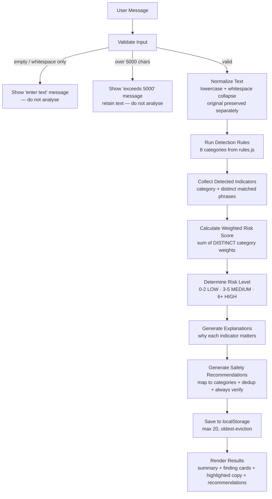

# Design Document: ScamShield MY

## Overview

ScamShield MY is an **explainable scam risk-awareness assistant** for Malaysians. A user pastes a suspicious message (SMS, WhatsApp, email, or any text), and the application analyses it entirely in the browser using transparent, deterministic, rule-based detection. Instead of returning a binary "Scam / Not Scam" verdict, it:

1. Identifies which parts of the message are warning signs (detected phrases per category).
2. Explains *why* each warning sign matters.
3. Assigns a transparent weighted **Risk Score** and a **Risk Level** (LOW / MEDIUM / HIGH).
4. Offers practical, deduplicated **Safety Recommendations**.
5. Saves the analysis to a local history for later review.

This design is a hackathon MVP: a static web application built with **HTML5, CSS3, and vanilla JavaScript**, using **localStorage** for persistence, deployable to a static host such as Vercel. All priorities — reliability, explainability, Malaysian relevance, professional cybersecurity UX, simple and debuggable architecture, fast (~4 hour) implementation, and a strong demo — flow directly from the requirements.

### How this design traces to requirements

| Design concern | Requirement(s) |
|---|---|
| Message input, 5000-char limit, validation, BM/English | Requirement 1 |
| Rule-based 8-category detection, case-insensitive, distinct phrases, truncation | Requirement 2 |
| Weighted scoring, thresholds, determinism, "not proof" text | Requirement 3 |
| Explainable per-indicator results, colour-independent levels, qualifying wording | Requirement 4 |
| Safety recommendations, mapping, dedup, always-verify | Requirement 5 |
| localStorage history, max 20, eviction, corruption/quota handling | Requirement 6 |
| Sample messages (≥3, ≥3 categories, one-click load) | Requirement 7 |
| Static browser-only, no backend/API, offline | Requirement 8 |
| Responsive, no horizontal scroll, distinct risk colours, no startle UI | Requirement 9 |
| Risk-awareness positioning, disclaimer, no binary verdict | Requirement 10 |

### Non-goals (explicit)

The following are **out of scope** for this MVP and must not be built:

- **No user accounts, authentication, or profiles.**
- **No backend server, API gateway, or serverless functions.**
- **No database** (persistence is local-only via `localStorage`).
- **No machine learning, NLP models, or AI inference** of any kind.
- **No chatbot / conversational interface.**
- **No external, paid, or network APIs** — the message must never leave the browser (Requirement 8.2).
- **No browser extension and no native mobile app.**
- **No complex build tooling** (no bundler, transpiler, or framework runtime required to run the app).

### Positioning

ScamShield MY is positioned strictly as a **risk-awareness tool, never a definitive scam detector** (Requirement 10). Every result is framed as *possible / potential* risk. The app never prints a "this is a scam" / "this is safe" verdict (Requirement 10.3), and a disclaimer stays visible alongside results (Requirement 10.1–10.2).

---

## Architecture

ScamShield MY is a **single-page, fully client-side application**. There is no network layer in the analysis path. The core is a **linear, deterministic analysis pipeline** that is intentionally easy to read, test, and debug: each stage takes the previous stage's output and produces the next, with no hidden state and no asynchronous branching inside the computation.

### Layered view

- **Presentation layer** (`index.html` + `css/style.css`): structure, styling, and the three views (Analyse / History / About).
- **Rule configuration layer** (`js/rules.js`): the indicator catalogue — the single source of truth for categories, weights, keywords, patterns, explanations, and recommended actions. Pure data, no logic.
- **Application layer** (`js/app.js`): the analysis pipeline, UI wiring, and storage access.

Because the engine reads its behaviour from `rules.js`, the "intelligence" of the app is **data-driven configuration**, not code — which is what keeps it debuggable and extensible.

### Analysis pipeline (Mermaid)



### Key architectural decisions

- **Deterministic and synchronous.** The pipeline is pure computation over strings and arrays. The same input always yields the same output (Requirements 2.7, 3.8). This is the single most important property for a reliable demo.
- **Configuration over code.** New scam patterns are added by editing data in `rules.js`; the engine never changes (Requirement 2).
- **No network in the hot path.** Analysis runs locally; the message is never transmitted (Requirement 8.2, 8.5).
- **Fail-soft storage.** History persistence is wrapped so that any storage failure never blocks the user from seeing results (Requirement 6.7, 6.8).
- **Easy to debug.** A linear pipeline with named stages means a failure can be localised to one stage by inspecting its input/output in the console.

---

## Project Structure

```text
scamshield-my/
├── index.html        # Single page: header, hero, analysis panel, results, history, about, disclaimer
├── css/
│   └── style.css     # Professional cybersecurity theme, responsive layout, risk colours
├── js/
│   ├── rules.js      # Indicator configuration (categories, weights, keywords, patterns, explanations, actions)
│   └── app.js        # Analysis pipeline, UI rendering/wiring, localStorage access
└── README.md         # Project summary, how to run, how to extend rules, deploy to Vercel
```

### Why `rules.js` is separate from `app.js`

The requirements make the rule catalogue the heart of the product (Requirements 2 and 3 define eight categories, their exact weights, and the phrases that trigger them). Separating configuration from logic gives real, concrete benefits for a hackathon:

- **Maintainability & extensibility.** Judges or teammates can add a new keyword or an entire category by editing a data object — no need to understand or touch the pipeline (satisfies the "add patterns without touching the engine" goal of Requirement 2).
- **Debuggability.** When a message is or isn't detected, you look in one place to understand why.
- **Testability.** The engine can be tested against synthetic rule sets; the rules can be reviewed as plain data.
- **Reviewability.** The eight categories and their weights (the "scoring contract" from Requirement 3) are visible in one file for verification.

`rules.js` is loaded before `app.js` in `index.html` so the global rule catalogue is available to the engine. No module bundler is required — plain `<script>` tags keep the build trivial (Requirement 8.3). We deliberately avoid adding any further files to keep the project small and easy to navigate.

---

## Components and Interfaces

Seven conceptual modules live inside `app.js` (plus the `rules.js` data). Each is a small, named function group — not a class hierarchy — to keep it beginner-friendly.

### 1. Message Input
**Responsibilities:** Render the textarea (5000-char cap), live character counter, Clear control, Sample Message control, and the "Analyse Message" CTA. Validate input before analysis: reject empty/whitespace-only (prompt the user), reject >5000 chars (show limit message, retain text), otherwise submit.
**Satisfies:** Requirement 1 (1.1–1.6), Requirement 7.4.

### 2. Scam Indicator Detection Engine
**Responsibilities:** Evaluate the normalized message against every category in `rules.js` using case-insensitive matching; record each distinct matched phrase per category; report each matched category exactly once; return zero indicators when nothing matches; truncate to first 5000 chars and flag truncation when needed. No AI, no probability.
**Satisfies:** Requirement 2 (2.1–2.8), Requirement 1.6.

### 3. Weighted Risk Scoring Engine
**Responsibilities:** Sum the weights of the **distinct** detected categories (each counted once even if matched multiple times); map the total to LOW/MEDIUM/HIGH via fixed thresholds; guarantee exactly one level and identical results on repeat analysis.
**Satisfies:** Requirement 3 (3.1–3.8, 3.11).

### 4. Explainable Analysis Results
**Responsibilities:** Build the threat-assessment summary (Risk Level, Risk Score, Indicators Detected count) and one **finding card** per detected indicator containing its matched phrases, points contributed, why-it-matters explanation, and recommended action. Render levels distinguishably without relying on colour (text label + icon). Render the highlighted copy of the message. Frame everything as *possible* risk; include the "score is not proof" text. Handle the zero-indicator case.
**Satisfies:** Requirement 3.9–3.10, Requirement 4 (4.1–4.7), Requirement 10.3–10.5.

### 5. Safety Recommendations
**Responsibilities:** Map each detected category to its recommended action; deduplicate; cap at the number of detected categories (≤8); always include the "verify through an independently obtained official channel" recommendation; provide the cautious-but-verify recommendation when zero indicators are detected.
**Satisfies:** Requirement 5 (5.1–5.7).

### 6. Sample Messages
**Responsibilities:** Hold ≥3 predefined samples spanning HIGH/MEDIUM/LOW and BM/English/mixed-language; load the full sample text into the textarea on one click, replacing existing content; the loaded text then behaves as any normal input.
**Satisfies:** Requirement 7 (7.1–7.4).

### 7. Analysis History
**Responsibilities:** After each analysis, persist an Analysis_Record to `localStorage`; keep at most 20 records with oldest-first eviction; list records newest-first on load; show a selected record's full details; clear all records on demand; survive corrupted data and quota errors gracefully.
**Satisfies:** Requirement 6 (6.1–6.8).

---

## Data Models

These are **conceptual schemas** expressed as commented JS object literals — not full implementations.

```js
// --- Indicator definition (one per category, defined in rules.js) ---
const indicatorExample = {
  id: 'otp_sensitive',                 // stable unique key for the category
  name: 'OTP / PIN / Password Request', // human-readable label
  weight: 3,                            // points contributed if detected (counted once)
  severity: 'high',                     // 'low' | 'medium' | 'high' — drives card emphasis
  keywords: ['otp', 'password', 'pin', 'kata laluan', 'nombor otp'], // literal phrases (case-insensitive)
  patterns: [/\botp\b/i],               // optional regexes for structural matches (e.g. links)
  explanation: 'Legitimate organisations never ask you to share a one-time ' +
               'code, PIN, or password. This is a common tactic to hijack accounts.',
  recommendedAction: 'Never share your OTP, PIN, or passwords with anyone.'
};

// --- Detection Result (one per detected category) ---
const detectedIndicatorExample = {
  category: 'otp_sensitive',           // matches an Indicator.id
  matchedPhrases: ['otp', 'kata laluan'], // distinct phrases found in the message
  points: 3                            // = the category weight (contributed once)
};

// --- Analysis Result (produced by the pipeline, used for rendering) ---
const analysisResultExample = {
  riskScore: 8,                        // sum of distinct detected category weights
  riskLevel: 'HIGH',                   // 'LOW' | 'MEDIUM' | 'HIGH'
  indicatorsDetected: 4,               // count of distinct detected categories
  findings: [ /* array of detectedIndicator objects, enriched for display */ ],
  recommendations: [ /* array of unique recommendation strings */ ],
  highlightedSegments: [               // for building the escaped, highlighted copy
    // { text: '...', highlighted: true/false, category?: 'otp_sensitive' }
  ],
  truncated: false                     // true if the message was clipped to 5000 chars
};

// --- Analysis_Record (one stored history entry) ---
const analysisRecordExample = {
  id: 'a1b2c3',                        // unique id (timestamp + random suffix)
  timestamp: 1719830400000,            // epoch ms, used for ordering + eviction
  messagePreview: 'Akaun anda disekat. Sahkan OTP...', // short preview for the list
  originalMessage: '...full untouched user text...',   // exact original, never mutated
  riskScore: 8,
  riskLevel: 'HIGH',
  detectedCategories: ['urgency', 'account_suspension', 'suspicious_link', 'otp_sensitive']
};

// --- Sample_Message ---
const sampleMessageExample = {
  id: 'sample_high_mixed',
  label: 'Bank account suspended (mixed BM/EN)',
  language: 'mixed',                   // 'bm' | 'en' | 'mixed'
  expectedRiskLevel: 'HIGH',           // for demo narration + testing
  text: 'URGENT! Akaun anda telah disekat. Verify now at http://bit.ly/xyz ...'
};
```

---

## Indicator Rule Structure

`rules.js` exposes a single ordered catalogue of the **eight categories** with the **exact weights defined in Requirement 3.1**. Each entry follows the Indicator schema above. Below is the structured approach (representative keywords/patterns in both English and Bahasa Melayu — the real file carries more phrases per category).

```js
// js/rules.js — single source of truth for detection behaviour
const SCAM_INDICATORS = [
  {
    id: 'urgency', name: 'Urgency / Pressure', weight: 1, severity: 'low',
    keywords: ['urgent', 'immediately', 'act now', 'right now', 'as soon as possible',
               'segera', 'sekarang', 'cepat', 'serta-merta'],
    patterns: [],
    explanation: 'Scammers create time pressure so you act before you think it through.',
    recommendedAction: 'Slow down. Genuine requests can wait for you to verify them.'
  },
  {
    id: 'threat_fear', name: 'Threat / Fear Tactics', weight: 2, severity: 'medium',
    keywords: ['you will be arrested', 'legal action', 'penalty', 'blocked', 'blacklist',
               'tindakan undang-undang', 'didenda', 'disaman', 'akan ditangkap'],
    patterns: [],
    explanation: 'Threats of arrest, fines, or legal action are used to frighten you into complying.',
    recommendedAction: 'Do not act out of fear. Official bodies do not threaten you by SMS/WhatsApp.'
  },
  {
    id: 'suspicious_link', name: 'Suspicious Link', weight: 2, severity: 'medium',
    keywords: ['click the link', 'click here', 'klik pautan', 'klik di sini', 'bit.ly', 'tinyurl'],
    patterns: [ /\bhttps?:\/\/[^\s]+/i,                 // any URL
                /\b[a-z0-9.-]+\.(xyz|top|info|click|link|tk)\b/i ], // risky TLDs
    explanation: 'Links may lead to fake login pages that steal your credentials.',
    recommendedAction: 'Do not click suspicious links. Type the official address yourself.'
  },
  {
    id: 'payment_transfer', name: 'Payment / Money Transfer', weight: 3, severity: 'high',
    keywords: ['transfer money', 'make payment', 'bank transfer', 'send money', 'deposit',
               'pindahkan wang', 'buat bayaran', 'pindah duit', 'bayar sekarang'],
    patterns: [],
    explanation: 'Requests to transfer money or make a payment are a direct route to financial loss.',
    recommendedAction: 'Do not transfer money based only on this message.'
  },
  {
    id: 'otp_sensitive', name: 'OTP / PIN / Password / Sensitive Info', weight: 3, severity: 'high',
    keywords: ['otp', 'one-time password', 'password', 'pin', 'cvv', 'tac',
               'nombor otp', 'kata laluan', 'nombor pin', 'maklumat sulit'],
    patterns: [],
    explanation: 'No legitimate organisation asks you to share an OTP, PIN, or password.',
    recommendedAction: 'Never share your OTP, PIN, or passwords with anyone.'
  },
  {
    id: 'prize_reward', name: 'Prize / Reward Claim', weight: 2, severity: 'medium',
    keywords: ['congratulations', 'you have won', 'claim your prize', 'free gift', 'lucky winner',
               'tahniah', 'anda telah menang', 'tuntut hadiah', 'hadiah percuma'],
    patterns: [],
    explanation: 'Unexpected prizes are a classic lure to collect your details or an advance fee.',
    recommendedAction: 'Be sceptical of unexpected winnings you never entered.'
  },
  {
    id: 'account_suspension', name: 'Account Suspension / Verification', weight: 2, severity: 'medium',
    keywords: ['account suspended', 'account blocked', 'verify now', 'verify your account',
               'reactivate', 'akaun disekat', 'akaun digantung', 'sahkan akaun', 'aktifkan semula'],
    patterns: [],
    explanation: 'Fake "your account is suspended, verify now" alerts push you to a phishing page.',
    recommendedAction: 'Check your account by logging in through the official app or website directly.'
  },
  {
    id: 'impersonation', name: 'Impersonation', weight: 2, severity: 'medium',
    keywords: ['this is your bank', 'from maybank', 'from cimb', 'lhdn', 'pos malaysia', 'jpj',
               'pihak bank', 'daripada bank', 'pihak berkuasa', 'kami dari'],
    patterns: [],
    explanation: 'Pretending to be a bank, agency, or courier builds false trust.',
    recommendedAction: 'Verify the sender through the organisation\'s official published contact.'
  }
];
```

Weights match Requirement 3.1 exactly: urgency 1; threat/fear 2; suspicious link 2; payment/transfer 3; OTP/PIN/password/sensitive 3; prize/reward 2; account suspension/verification 2; impersonation 2.

### Adding new patterns without touching the engine

Because the engine iterates `SCAM_INDICATORS` generically, extending detection is a pure data edit:

- **Add a keyword/phrase** to a category: append a string to that category's `keywords`.
- **Add a structural rule** (e.g. a new URL shape): append a regex to that category's `patterns`.
- **Add a whole new category**: append a new indicator object with its own `id`, `weight`, `keywords`, etc.

No change to the detection loop, scoring, or rendering is required — the new data is picked up automatically.

---

## Text Normalization Strategy

Normalization exists **only to make matching robust**; it never alters what the user sees or what is stored.

- **Case-insensitive matching** (Requirement 2.4): matching is performed on a lowercased copy of the message, and literal keywords are compared in lowercase; regex patterns carry the `i` flag.
- **Whitespace handling**: in the normalized copy, runs of whitespace (spaces, tabs, newlines) are collapsed to single spaces and the string is trimmed, so phrases split across line breaks still match. Punctuation is left in place.
- **Original preserved unmodified**: the pipeline keeps two strings — `originalMessage` (exactly what the user pasted) and `normalizedMessage` (used only for detection). The original is what gets stored, displayed, and highlighted-from. Normalization is a read-only derivation.
- **5000-character limit** (Requirement 1.1, 1.5, 2.8): the input is capped at 5000 characters. If a message arrives longer than 5000 characters at analysis time, only the first 5000 characters are normalized and evaluated, and a `truncated: true` flag is set so the UI can indicate the message was truncated for analysis. The textarea itself also discourages exceeding the limit via the live character counter, and the submit-time check (Requirement 1.5) blocks over-limit submissions with a clear message while retaining the user's text.

---

## Detection Algorithm

Detection is **deterministic, rule-based substring/regex matching** over the normalized text — no AI, no probabilistic classification (Requirement 2, 3.11).

Procedure:

1. Normalize the message (lowercase + whitespace collapse), keeping the original intact.
2. For each category in `SCAM_INDICATORS`:
   - For each keyword, check whether it occurs in the normalized text (case-insensitive).
   - For each regex pattern, test it against the normalized (or original-cased, `i`-flagged) text.
   - Collect every **distinct** matched phrase for that category into `matchedPhrases` (deduplicated).
3. A category is "detected" if it has at least one matched phrase. Each detected category is reported **exactly once** (Requirement 2.3), with `points` equal to its weight.
4. If no category matches, return an empty detected set (Requirement 2.6).

Important nuance (Requirement 2.3 + 3.3): a category matched **multiple times** still records **all** its distinct matched phrases (useful for explainability), but it is reported once and contributes its weight **only once** to the score. So "multiple matches → multiple phrases, single category, single weight."

Language support (Requirement 1.6, 2.4): because each category's `keywords` list carries both English and Bahasa Melayu phrases, a message in BM, English, or a mix of both is handled by the same single pass — mixed-language messages simply match keywords from more than one language.

Performance (Requirement 2.1): the whole pass is O(categories × keywords) over a ≤5000-char string — effectively instantaneous, far under the 2-second budget.

---

## Weighted Scoring Algorithm

Scoring is the **sum of the weights of the distinct detected categories**, each counted once (Requirement 3.1–3.3).

```text
riskScore = Σ weight(c)  for each distinct category c in detectedCategories
```

Threshold mapping (Requirement 3.4–3.6) — a total function covering every possible non-negative score:

| Risk Score | Risk Level |
|---|---|
| 0, 1, 2 | LOW |
| 3, 4, 5 | MEDIUM |
| 6 or greater | HIGH |

Properties guaranteed:
- Exactly one level is assigned (Requirement 3.7).
- No probability percentages, no AI (Requirement 3.11) — the score is a plain integer sum.
- Repeat analysis of the same message yields an identical score and level (Requirement 3.8).

### Worked critical demo scenario (Requirement 3)

A mixed-language message that triggers four categories:

| Detected category | Weight |
|---|---|
| Urgency | +1 |
| Account suspension / verification | +2 |
| Suspicious link | +2 |
| OTP / PIN / password / sensitive | +3 |
| **Total** | **8** |

Risk Score = 8 → **HIGH** (8 ≥ 6). This is the anchor demo scenario and is covered by an explicit end-to-end test (see Testing Strategy). It traces directly to Requirement 3.1–3.6.

---

## Explainability Mechanism

Explainability is the product's core value (Requirement 4). For each detected indicator, the UI surfaces a **security finding card** containing:

1. **Category name** — e.g. "OTP / PIN / Password Request" (the indicator's `name`).
2. **Detected phrase(s)** — the distinct `matchedPhrases` found in *this* message (Requirement 4.3). If a detected indicator somehow has zero phrases (e.g. a future pattern-only rule), the card still renders with its explanation and no phrase list (Requirement 4.4).
3. **Risk points contributed** — the category `weight` (e.g. "+3 points"), making the score transparent (Requirement 3.9).
4. **Why it matters** — the indicator's `explanation`, at least one sentence (Requirement 4.5).
5. **Recommended action** — the indicator's `recommendedAction`.

Every card uses **qualifying language** — "possible warning sign", "may indicate" — and never states a confirmed verdict (Requirement 4.6, 10.5). The summary panel always shows the "this score reflects the presence of risk indicators and is not proof of a scam" text (Requirement 3.10).

---

## Message Highlighting Approach

The app highlights detected phrases inside a **rendered copy** of the message so the user can see warning signs in context — without ever mutating the original input (Requirement 2.5 explainability, original-preservation invariant).

Strategy (simple and reliable):

1. Start from the **original** message string (never the normalized one).
2. Collect all match spans (start/end offsets) across all detected phrases. To keep overlapping matches reliable, merge overlapping or adjacent spans into a single highlighted span (so no span boundary falls inside another). This avoids broken/nested markup.
3. Walk the string left to right, emitting alternating plain and highlighted segments as `highlightedSegments`.
4. **HTML-escape every segment's text** before inserting it into the DOM, then wrap highlighted segments in a `<mark>`-style element via `textContent`/escaped insertion.

### Security consideration (critical)

The pasted message is **untrusted input**. It may contain `<`, `>`, `&`, quotes, or `<script>`-like fragments. The highlighted copy must be built so that:

- Every character of the user's content is HTML-escaped (`&` → `&amp;`, `<` → `&lt;`, `>` → `&gt;`, `"` → `&quot;`, `'` → `&#39;`).
- No portion of the pasted content is ever inserted as raw HTML (no `innerHTML` with user text). Highlight wrappers are added by the app around already-escaped text, never by trusting the input.

This prevents HTML/script injection from a pasted message — essential because the whole point is to paste hostile content.

---

## Safety Recommendation Logic

Recommendations are derived from the detected categories (Requirement 5).

- **Mapping**: each detected category contributes its `recommendedAction` (at most one per category) — Requirement 5.1, 5.2.
- **Category-specific guarantees**:
  - OTP/sensitive detected → "do not share OTP, PIN, or passwords" (Requirement 5.3).
  - Suspicious link detected → "do not click suspicious links" (Requirement 5.4).
  - Payment/transfer detected → "do not transfer money based only on this message" (Requirement 5.5).
- **Always include verify-through-official-channel**: whenever ≥1 indicator is detected, add the recommendation to verify the request through an **independently obtained** official channel (Requirement 5.6). This is appended to the mapped set.
- **Deduplicate**: the final list is deduplicated so no recommendation appears twice (Requirement 5.2). Count stays within 1–8 because there are at most 8 categories plus the always-included verify item folded into the unique set.
- **Zero-indicator case** (Requirement 5.7, 4.7): when nothing is detected, show a single recommendation advising the user to stay cautious and to verify unexpected requests through an independently obtained official channel. The result also states that no common scam indicators were found.

Traces to Requirement 5 in full.

---

## localStorage Schema

History is persisted in `localStorage` (Requirement 6).

- **Key**: `scamshield_history_v1` (versioned so a future format change is safe).
- **Shape**: a JSON array of Analysis_Record objects (see Data Models), newest-first or sorted on read.

```json
[
  {
    "id": "a1b2c3",
    "timestamp": 1719830400000,
    "messagePreview": "Akaun anda disekat. Sahkan OTP...",
    "originalMessage": "URGENT! Akaun anda telah disekat...",
    "riskScore": 8,
    "riskLevel": "HIGH",
    "detectedCategories": ["urgency", "account_suspension", "suspicious_link", "otp_sensitive"]
  }
]
```

Rules and resilience:

- **Max 20 records with oldest-eviction** (Requirement 6.2, 6.3): before saving a new record, if the store already holds 20, drop the oldest (lowest timestamp) first.
- **Ordering on load** (Requirement 6.4): records are displayed most-recent → oldest by timestamp.
- **localStorage unavailable** (e.g. private mode throwing, or disabled): all storage access is wrapped in try/catch. If reading fails, the app treats history as empty and continues; if writing fails, the UI still shows the current analysis result — persistence is best-effort, never blocking.
- **Corrupted data** (Requirement 6.7): if the stored value is not valid JSON or is not an array of well-shaped records, the loader returns an empty list and the app continues (no crash).
- **Quota exceeded** (Requirement 6.8): if `setItem` throws a quota error, evict the oldest record and retry once; if it still fails, keep operating and still show the analysis result (never surface results as unavailable).

Traces to Requirement 6 in full.

---

## UI Component Structure

A single page with three navigable views (Analyse / History / About), composed of:

- **Navigation header**: shield logo mark, product name **"ScamShield MY"**, subtitle **"Explainable Scam Risk Assistant"**, and nav links **Analyse · History · About**.
- **Hero**: headline **"Think Before You Trust."** with supporting text explaining that the tool highlights possible scam warning signs and explains why they matter (not a verdict).
- **Analysis panel**:
  - a labelled **textarea** for the message,
  - a **character counter** (e.g. `128 / 5000`),
  - a **Sample Message** control (menu/buttons to load a sample),
  - a **Clear** control (empties the textarea),
  - the primary CTA **"Analyse Message"**.
- **Threat assessment summary**: **Risk Level**, **Risk Score**, **Indicators Detected** count, and a **risk meter** that reflects the LOW/MEDIUM/HIGH band. The meter shows the discrete level and score — **no fabricated probability percentage** (Requirement 3.11, 9.4).
- **Security finding cards**: one card per detected indicator (category, phrases, points, explanation, recommended action).
- **Recommended Safety Actions panel**: the deduplicated recommendation list.
- **Highlighted message copy**: the escaped, highlighted rendering of the message.
- **History interface**: list of saved analyses (newest first) with preview, level badge, timestamp; selecting one shows its full stored detail; a **Clear History** control.
- **Disclaimer**: visible on the results view at all times (Requirement 10.1, 10.2).

### Disclaimer wording

> **ScamShield MY is a risk-awareness tool, not a definitive scam detection service.** It highlights possible warning signs in a message and explains why they may be risky. A LOW result does not guarantee a message is safe, and a HIGH result does not prove a message is a scam. Always verify unexpected requests through an official channel you obtain independently.

---

## Visual Identity / Design Direction

A calm, credible, **professional cybersecurity** look that signals trust without theatrics (Requirement 9.5).

- **Core palette**: dark navy / deep security blue as the primary brand/surface tone; white, light-neutral, and blue-grey for content surfaces and cards; a cyan / professional-blue accent for primary actions and focus.
- **Risk colours** (used **only** for status/finding emphasis, never as decoration): **LOW = green**, **MEDIUM = amber/orange**, **HIGH = red**. These are paired with a text label and an icon so they never carry meaning by colour alone (Requirement 4.2, 9.4).
- **Avoid**: matrix/code-rain backgrounds, neon glow, "hacker" clichés, frightening or startle imagery, flashing/blinking, all-caps alarm headings (Requirement 9.5), and heavy national imagery. **Malaysian relevance is expressed through language and detection patterns (BM/English), not flags or national symbols.**
- **Typography**: a clean, legible sans-serif; comfortable line length; clear hierarchy between the summary, cards, and recommendations.

---

## Responsive Design Strategy

Mobile-first, with layouts verified to never require horizontal scrolling (Requirement 9.1–9.3).

- **Base (mobile-first)**: single-column, fluid widths, generous spacing.
- **320–768 px (mobile / small tablet)**: single-column stack — header, input panel, summary, finding cards, recommendations, history. Input and CTA stay fully visible and operable (Requirement 9.3).
- **769 px and up (desktop)**: a dashboard composition — e.g. input panel alongside a results column, finding cards in a responsive grid — optimised for a **projector demo**. Still no horizontal scroll (Requirement 9.2).
- **Touch targets**: large, finger-friendly controls (comfortable minimum tap size) with adequate spacing.
- **No horizontal scrolling** at any width ≥320 px; content reflows rather than overflowing.

Implemented with CSS media queries and flexible layout (flexbox/grid); no framework required (Requirement 8.3).

---

## Correctness Properties

*A property is a characteristic or behaviour that should hold true across all valid executions of the system — a formal statement about what the system should do. Properties bridge human-readable specifications and machine-verifiable correctness guarantees.*

These properties are exercised by the property-based tests described in the Testing Strategy (minimum 100 generated inputs each).

### Property 1: Scoring is the sum of distinct detected category weights
*For any* message, the computed Risk Score equals the sum of the configured weights of the distinct detected Risk_Indicator categories, and each detected category appears exactly once in the detected set.
**Validates: Requirements 2.3, 3.1, 3.2**

### Property 2: Duplicate matches of a category do not change the score
*For any* message, adding further occurrences of keywords belonging to a category that is already detected leaves the Risk Score unchanged.
**Validates: Requirements 3.3**

### Property 3: Score-to-level mapping is total and single-valued
*For any* non-negative integer Risk Score, the mapping returns exactly one Risk Level, and that level is LOW iff the score is ≤ 2, MEDIUM iff the score is 3–5, and HIGH iff the score is ≥ 6.
**Validates: Requirements 3.4, 3.5, 3.6, 3.7**

### Property 4: Analysis is deterministic
*For any* message, analysing it twice produces an identical set of detected categories, identical detected phrases, an identical Risk Score, and an identical Risk Level.
**Validates: Requirements 2.7, 3.8**

### Property 5: Matching is case-insensitive
*For any* message, re-casing (changing the upper/lower case of) its characters does not change the set of detected Risk_Indicator categories.
**Validates: Requirements 2.4**

### Property 6: Detected phrases are genuine
*For any* message, every recorded Detected_Phrase for a category is drawn from that category's configured keywords/patterns and actually occurs in the normalized message.
**Validates: Requirements 2.5**

### Property 7: Original input is never mutated
*For any* input string, running the full analysis pipeline leaves the preserved original message exactly equal to the input (normalization is used only for matching and never alters the stored/displayed source).
**Validates: Requirements 2.5, 4.3**

### Property 8: Highlighted copy is injection-safe
*For any* pasted input containing HTML-significant characters (`<`, `>`, `&`, quotes) or script-like fragments, the rendered highlighted copy contains those characters only in escaped form and introduces no new live markup derived from the input.
**Validates: Requirements 2.5**

### Property 9: Recommendations are mapped, unique, and bounded
*For any* non-empty set of detected categories, the generated recommendation list contains no duplicates, every category-specific recommendation maps to a detected category, the verify-through-official-channel recommendation is always present, and the total count is between 1 and 8.
**Validates: Requirements 5.1, 5.2, 5.6**

### Property 10: History is capped and ordered
*For any* sequence of saved Analysis_Records, the History_Store never holds more than 20 records, retains exactly the 20 most recent by timestamp (evicting oldest first), and the display order is non-increasing by timestamp.
**Validates: Requirements 6.2, 6.3, 6.4**

---

## Error Handling

All error paths produce **human-friendly messages — never stack traces**.

| Condition | Handling | Requirement |
|---|---|---|
| Empty / whitespace-only input | Inline prompt: "Please enter a message to analyse." No analysis runs. | 1.4 |
| Input > 5000 characters | Inline message: "Message exceeds the 5000-character limit." Text retained, no analysis. | 1.5 |
| Message truncated at analysis (first 5000 chars) | Non-blocking notice: "Only the first 5000 characters were analysed." | 2.8 |
| localStorage unavailable | Catch and continue; history simply shows empty; results still render. | 6.7 (robustness) |
| Corrupted history data | Loader returns empty list; app continues normally. | 6.7 |
| Quota exceeded on save | Evict oldest, retry once; if still failing, keep operating and still show results. | 6.8 |
| No indicators detected | Friendly "no common scam indicators found" result + stay-cautious/verify advice. | 4.7, 5.7 |
| Unexpected analysis error | Wrap the pipeline in a guard; show a calm "Something went wrong analysing this message. Please try again." message; log details to console only. | general robustness |

---

## Accessibility

- **Semantic HTML**: landmarks (`header`, `main`, `nav`, `section`), real `<button>`/`<textarea>`/`<label>` elements, headings in order.
- **Keyboard accessibility**: every control reachable and operable by keyboard; logical tab order; Enter/Space activate controls; no keyboard traps.
- **Visible focus states**: a clear, high-contrast focus ring on all interactive elements (not removed).
- **Labels**: the textarea has an associated `<label>`; the character counter and sample controls are labelled.
- **Contrast**: text and UI meet strong contrast against navy/light surfaces; risk colours chosen with sufficient contrast.
- **Risk level not by colour alone** (Requirement 4.2, 9.4): each level shows a **text label** (LOW/MEDIUM/HIGH) **and an icon** in addition to colour.
- **ARIA**: results region announced via a polite live region (`aria-live="polite"`) so screen-reader users hear the outcome; risk meter has an accessible text equivalent; icons that convey meaning have accessible labels, decorative icons are hidden from assistive tech.

---

## Micro-interactions

Subtle, fast, and never delaying analysis or the demo (Requirement 9.5 forbids flashing/startle):

- **Card hover**: gentle elevation/shadow shift on finding cards.
- **Button hover/focus**: slight colour/scale change on the CTA and nav; clear focus ring.
- **Result reveal**: a short fade/slide-in of the results region after analysis.
- **"Analysing…" state**: the CTA briefly shows an analysing label/spinner, then results appear (analysis itself is instant; the state is reassurance, not a real delay).
- **Risk meter**: a brief, subtle fill animation to the correct band.

No blinking/flashing elements; animations are short and respect reduced-motion preferences.

---

## Testing Strategy

A practical, hackathon-appropriate mix of **lightweight pure-function unit tests** (fast, high value, run in-browser or with a tiny harness) and **manual end-to-end checks**. Property-based testing **is appropriate here** for the pure detection/scoring/recommendation/storage logic because those are deterministic functions with clear input/output behaviour and a large input space; UI, responsiveness, and browser-storage integration are verified by example/manual tests instead.

### What to test

| Check | Type | Requirement |
|---|---|---|
| Detection fires for **all 8 categories** (one representative message each) | Unit (pure) | 2.2 |
| **BM / English / mixed-language** detection | Unit (pure) | 1.6, 2.4 |
| **Weighted score** = sum of distinct category weights | Unit (pure) + Property | 3.1–3.2 |
| **LOW/MEDIUM/HIGH thresholds** (0–2 / 3–5 / 6+) | Unit (pure) + Property | 3.4–3.6 |
| **Duplicate category counts weight once** | Unit (pure) + Property | 3.3 |
| **Highlighting** of matched phrases + HTML escaping of pasted content | Unit (pure) + manual | 2.5, security |
| **Recommendation generation + dedup** + always-verify | Unit (pure) + Property | 5.1–5.7 |
| **localStorage save/load**, max 20, oldest-eviction | Unit (pure, mocked storage) + Property | 6.1–6.4 |
| **Clear history** empties the store and the view | Manual E2E | 6.6 |
| **Sample messages** load into textarea on one click | Manual E2E | 7.1–7.4 |
| **Responsive UI** (320/375/768/1280/1920), no horizontal scroll | Manual E2E | 9.1–9.3 |
| **Empty-input validation** blocks analysis with a prompt | Unit + manual | 1.4 |
| Corrupted / unavailable / quota localStorage | Unit (mocked) | 6.7–6.8 |
| **Critical demo scenario: score = 8 → HIGH** (end-to-end) | Explicit E2E | 3.1–3.6 |

### Property test configuration

Where property-based tests are used, they run a **minimum of 100 generated inputs** per property using a lightweight JS property-testing library (e.g. a small `fast-check`-style harness) — **not implemented from scratch**. Each property test is tagged with a comment referencing the design property, format: **`Feature: scamshield-my, Property {n}: {property text}`**.

### Testable correctness properties

The property-based tests above validate the formal correctness properties defined in the dedicated **[Correctness Properties](#correctness-properties)** section (Properties 1–10). Each property maps to one property-based test configured to run a minimum of 100 generated inputs.

### Edge cases and integration/smoke checks (not property-based)

- **Zero-indicator result** (Requirement 2.6, 4.7): concrete benign messages produce zero indicators and the cautious-but-verify result.
- **Truncation at 5000 chars** (Requirement 2.8): a >5000-char input is analysed on its first 5000 chars with the truncation flag set.
- **Corrupted / unavailable history** (Requirement 6.7): malformed stored data yields an empty history without throwing.
- **Quota-exceeded retry** (Requirement 6.8): a mocked storage that throws once triggers oldest-eviction and a successful retry; results stay visible.
- **No network transmission** (Requirement 8.2): code review + manual network-tab check that analysis issues no requests.
- **Responsive / no-horizontal-scroll** (Requirement 9): manual checks at representative widths.

---

## Sample Messages

At least three predefined samples (Requirement 7), spanning HIGH/MEDIUM/LOW and BM/English/mixed-language, each triggering ≥1 indicator and collectively covering ≥3 categories. One click loads the full text into the textarea, replacing existing content (Requirement 7.3–7.4).

1. **HIGH — mixed BM/English (the critical demo sample)**
   *"URGENT! Akaun anda telah disekat. Verify now at http://bit.ly/xyz-bank or your account will be blocked. Sahkan OTP anda sekarang untuk aktifkan semula."*
   Triggers urgency (+1), account suspension/verification (+2), suspicious link (+2), OTP/sensitive (+3) → score 8 → **HIGH**.

2. **MEDIUM — English**
   *"Congratulations! You have won a RM5,000 shopping voucher. Click here to claim your prize before it expires."*
   Triggers prize/reward (+2) and suspicious link (+2) → score 4 → **MEDIUM**.

3. **LOW — Bahasa Melayu**
   *"Tahniah, anda layak menyertai cabutan bertuah bulan ini."*
   Triggers prize/reward (+2) → score 2 → **LOW** (also demonstrates that a single low-weight match stays LOW).

4. *(Optional 4th — LOW/benign English)*
   *"Hi, are we still on for lunch tomorrow at 1pm?"* → zero indicators → **LOW**, exercising the no-indicator path.

Each sample carries an `expectedRiskLevel` for demo narration and to anchor tests.

---

## Hackathon Implementation Priorities

Ordered for the ~4-hour build — get a working, demoable pipeline first, then explainability, then polish:

1. **Working pipeline (must-have):** `rules.js` with all 8 categories/weights; input + validation; detection; weighted scoring; LOW/MEDIUM/HIGH; render a basic result. This alone satisfies the core demo (Requirements 1, 2, 3).
2. **Explainability (core value):** finding cards (category, phrases, points, explanation, recommended action); qualifying wording; "not proof" text; zero-indicator path (Requirement 4).
3. **Safety recommendations + highlighting:** mapped/deduped recommendations with always-verify; escaped highlighted copy (Requirements 5, security).
4. **History:** localStorage save/load, max-20 eviction, newest-first list, clear, corruption/quota resilience (Requirement 6).
5. **Samples:** one-click sample loading, including the HIGH demo sample (Requirement 7).
6. **Polish:** professional theme, responsive layout for projector, accessibility, subtle micro-interactions, disclaimer placement (Requirements 9, 10).
7. **Testing:** pure-function unit/property tests for scoring/detection/recommendations/storage; manual E2E for UI/responsive; the explicit score-8-HIGH end-to-end check.

### Explicit future enhancements (out-of-scope for MVP)

- User accounts and profiles.
- A backend service / API.
- Machine learning or AI-based detection.
- A browser extension.
- A native mobile app.
- Any external/paid AI or threat-intelligence API integration.

These are intentionally deferred so the MVP stays reliable, fully offline, and demoable within the hackathon window.
